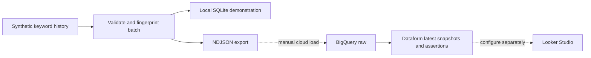

# Synthetic keyword-demand modelling template

Local Python/SQLite demo with a compile-tested BigQuery/Dataform model; Google Ads API and cloud execution are not included.

A synthetic search-demand reporting example: repeatable keyword-history ingestion, latest-snapshot modelling and Dataform quality assertions. Search-demand counts are distinct from campaign spend or conversions.

## Example result
`make demo` loads two synthetic snapshots, then repeats the same inputs safely. For `demo running shoes`, US/en:

| Month | April 1 snapshot | April 2 revision | Latest reporting value |
|---|---:|---:|---:|
| 2026-01-01 | 50 | 60 | 60 |
| 2026-02-01 | 100 | 110 | 110 |
| 2026-03-01 | 150 | 160 | 160 |

Three keywords × three months produce nine reporting rows from 18 stored snapshot rows. Open `output/report.json` for named fields and `output/keyword_monthly.ndjson` for both export snapshots. Values are invented; they illustrate corrected demand history, not campaign performance.

## Run locally
Python 3.10+ and Node.js 20+.
```sh
npm ci
make demo
npm test
```
Python runs a synthetic source through SQLite to demonstrate idempotent loading and revision handling. Dataform compiles the BigQuery SQLX graph locally. The SQLite query is a separate demonstration of the transformation; it is not a BigQuery emulator or proof of cloud SQL execution.

## Architecture


The exported NDJSON and BigQuery schema are ready for a sandbox load. `definitions/search_demand.sqlx` chooses the latest extraction for each keyword, geography, language and month. Seven Python tests cover repeat runs, revisions, invalid dates/types, timezone normalisation, conflicting equal-time snapshots, atomic rejection and geography isolation.

## Boundaries
No client code, credentials or data. No Google Ads API calls, live Sheets interface, Cloud Run deployment or Looker dashboard is supplied. Dataform compilation is tested; BigQuery execution needs an explicitly configured GCP sandbox. The committed project ID is a placeholder. Synthetic volumes are invented, not measured demand.

[Cloud adaptation and checks](docs/architecture.md). MIT licence.

## Snapshot contract
Month must be YYYY-MM-01. Extraction timestamps must include timezone and are normalised to UTC before hashing/loading. A different value at the same extraction time is rejected; a correction must carry a later timestamp. All keys and types are validated before insertion. Raw cloud loaders must enforce this same policy; compilation alone does not validate incoming data.

## Adaptation
I would implement a credentialled source adapter, staging/MERGE loads, execution assertions and source reconciliation in a sandbox before scheduling or connecting a dashboard. This repository demonstrates the local contract and provides cloud modelling assets; it does not claim an executed Google Ads-to-BigQuery deployment.

[CI checks](https://github.com/zoercalm/google-ads-bigquery-dataform-template/actions/workflows/ci.yml)
