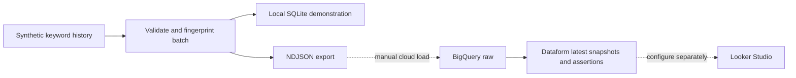

# Google Ads → BigQuery → Dataform template

A synthetic search-demand reporting example: repeatable keyword-history ingestion, latest-snapshot modelling and Dataform quality assertions. Search-demand counts are distinct from campaign spend or conversions.

## Run locally
Python 3.10+ and Node.js 20+.
```sh
npm ci
make demo
npm test
```
Python runs a synthetic source through SQLite to demonstrate idempotent loading and revision handling. Dataform compiles the BigQuery SQLX graph locally. The SQLite query is a separate demonstration of the transformation; it is not a BigQuery emulator or proof of cloud SQL execution.

## Architecture


The exported NDJSON and BigQuery schema are ready for a sandbox load. `definitions/search_demand.sqlx` chooses the latest extraction for each keyword, geography, language and month. Four Python tests cover repeat runs, corrections, malformed exports and geography isolation.

## Boundaries
No client code, credentials or data. No Google Ads API calls, live Sheets interface, Cloud Run deployment or Looker dashboard is supplied. Dataform compilation is tested; BigQuery execution needs an explicitly configured GCP sandbox. The committed project ID is a placeholder. Synthetic volumes are invented, not measured demand.

[Cloud adaptation and checks](docs/architecture.md). MIT licence.
